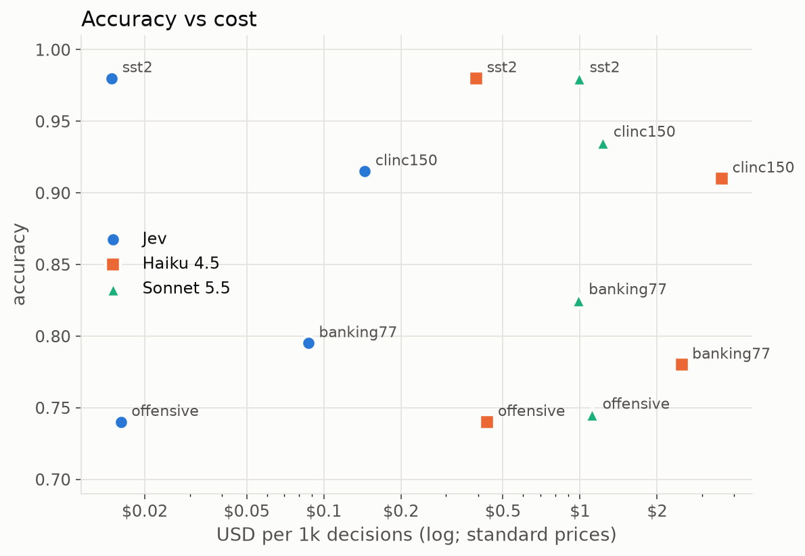
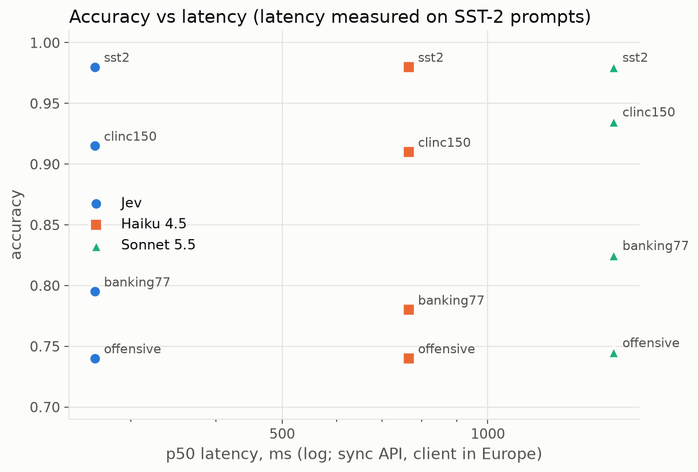
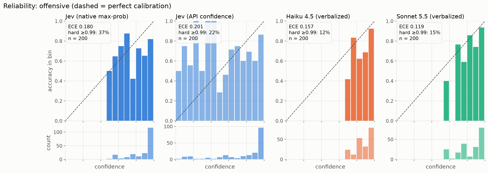

# jev-bench

**A reproducible benchmark of TypeSafe's Jev, a "System One" decision model, against Claude Haiku 4.5 and Claude Sonnet 5.5 used as classifiers.** It measures accuracy, latency, cost and, above all, whether each model's confidence can be trusted.

Jev returns a typed choice plus a probability for every option instead of free text. It cannot invent an option, but it can still pick the wrong one with high confidence. TypeSafe publishes speed, cost and "can't hallucinate" claims without a public benchmark, so this project tests them on four public datasets, under identical conditions, with every number traceable to a logged API call.

## Headline results

200 stratified examples per dataset; the same examples, labels and label descriptions for every model. Full tables with 95% bootstrap CIs are in [`results/summary.md`](results/summary.md).

| | Jev | Claude Haiku 4.5 | Claude Sonnet 5.5 |
|---|---|---|---|
| **Accuracy** (SST-2 / Banking77 / CLINC150 / offensive) | 98.0 / 79.5 / 91.5 / 74.0 % | 98.0 / 78.0 / 91.0 / 74.0 % | 98.0 / 82.5 / 93.5 / 74.5 % |
| **p50 latency** (sync API) | **266 ms** | 767 ms | 1,527 ms |
| **p99 latency** | **653 ms** | 1,437 ms | 3,902 ms |
| **Cost per 1k decisions** | **$0.015–0.145** | $0.20–1.79 (batch) | $0.49–0.61 (batch, with prompt caching) |
| **AUROC of confidence** (Banking77 / CLINC150) | 0.85 / **0.90** | 0.81 / 0.72 | 0.85 / 0.86 |
| **ECE** (SST-2) | **0.023** | 0.086 | 0.070 |
| **Failures** (invalid output, refusal, API error) | 0 / 800 | 0 / 800 | 0 / 800 |

What the data says:

1. **Same accuracy, much faster and cheaper.** Jev is statistically tied with both Claude models on every dataset (all differences sit inside the 95% CIs). Its median latency is 2.9× lower than Haiku's and 5.7× lower than Sonnet's, and it costs 4–14× less than the cheapest Claude option on each dataset (Batch API, with caching) and 8–69× less than Claude at standard prices.
2. **Real probabilities help rank answers.** On the intent datasets Jev's confidence separates right from wrong answers as well as or better than either LLM (AUROC 0.90 vs 0.72/0.86 on CLINC150), and it is the best-calibrated model on SST-2.
3. **Confidence is not certainty.** Jev puts ≥0.99 on 37–72% of its answers. On the hardest task (offensive-language detection, 74% accuracy for all three models) 12.5% of its answers are wrong at ≥0.9 confidence, versus 8.0% for Haiku and 5.0% for Sonnet. "Can't hallucinate an option" does not mean "can't be confidently wrong".
4. **A bigger LLM calibrates better, mostly.** Sonnet beats Haiku on AUROC on 3 of 4 datasets and has fewer confident-but-wrong answers on 3 of 4, but Haiku has the lower ECE on CLINC150.
5. **Self-consistency is a poor confidence signal here.** Sampling Haiku 5 times (temperature 1.0) gave unanimous answers on 93 of 100 Banking77 examples, wrong ones included: AUROC 0.54 and 21% wrong at "100% agreement", at 5× the cost of asking once.

<p align="center">
  
  
</p>



## Method

### Models and how they are asked

| | Jev | Claude (Haiku 4.5, Sonnet 5.5) |
|---|---|---|
| Interface | `system_one` with one `Choice` question (option → description) | Messages API with a JSON-schema structured output `{label: enum, confidence: number}` |
| Output | chosen option + a probability for every option | chosen label + a **verbalized** confidence in [0, 1] |
| Sampling | n/a | Haiku: temperature 0. Sonnet 5.5 rejects non-default sampling parameters, so it runs at the default, with thinking disabled (`between_tools`) |
| Accuracy runs | sync API, concurrency 4 | Message Batches API (50% off) |
| Latency runs | sync API, concurrency 4 | sync Messages API, concurrency 4, no prompt caching |

Both models receive the same task instruction and the same one-line description for every label, generated from one file per dataset in [`src/jev_bench/datasets/labels/`](src/jev_bench/datasets/labels).

### Confidence, labeled everywhere

- **Jev, native max-prob**: the largest value in the returned distribution. This is the calibration target.
- **Jev, API confidence**: Jev's own `confidence` field, a measure of how concentrated the whole distribution is (1 when all mass is on one option, 0 when it is uniform). It is reported separately; it never beats max-prob for calibration and is clearly worse on the binary tasks.
- **Claude, verbalized**: the model states its own probability. Claude exposes no token probabilities in this setup, so this is a weaker signal than Jev's distribution by construction. That asymmetry is part of what the benchmark measures.
- **Claude, self-consistency** (Haiku, Banking77, 100 examples): agreement rate across k = 5 samples at temperature 1.0.

### Datasets

| Dataset | Task | Classes | Split | Source |
|---|---|---|---|---|
| SST-2 | movie-review sentiment | 2 | validation | `stanfordnlp/sst2` |
| Banking77 | banking intent | 77 | test | `legacy-datasets/banking77` |
| CLINC150 (plus) | assistant intent + out-of-scope | 151 | test | `clinc/clinc_oos` |
| tweet_eval offensive | offensive-language detection | 2 | test | `cardiffnlp/tweet_eval` |

Samples are seeded and stratified, and every sample is a prefix of one fixed class-balanced ordering, so the 20-example development sample is exactly the first 20 of the 200-example one and each class stays within one example of its population share.

### Metrics

Accuracy and macro-F1 (failures count as wrong), ECE and MCE (15 equal-width bins), top-label Brier score, AUROC of confidence for correct vs. wrong (ties count ½), confident-but-wrong rate at 0.8 and 0.9, selective accuracy vs. coverage, share of hard (≥ 0.99) predictions, latency p50/p95/p99, cost per 1k decisions, and failure rates by type. Accuracy and ECE get percentile-bootstrap 95% CIs (1,000 resamples).

Calibration metrics use answered predictions only, since a failure has no confidence; failures are reported separately and are never dropped. Brier is computed on the chosen label because Claude gives no full distribution, which keeps it comparable across models.

### Cost accounting

Every cost comes from the `usage` block of a real API response multiplied by the prices in [`config/bench.yaml`](config/bench.yaml): Jev $0.042/M input tokens (output free); Haiku 4.5 $1/$5 per M; Sonnet 5.5 $2/$10 per M; 50% off through the Batches API; prompt-cache writes at 1.25× and reads at 0.1× of input. The whole benchmark, including development runs, cost **$1.82** of Anthropic credit and about **$0.06** of Jev credit.

## Reproduce it

Requires [uv](https://docs.astral.sh/uv/) and Python 3.11, plus API keys for TypeSafe and Anthropic.

```bash
git clone https://github.com/endikoci02/jev-bench.git
cd jev-bench
uv sync
cp .env.example .env              # then fill in TYPESAFE_API_KEY and ANTHROPIC_API_KEY

uv run jev-bench estimate         # call counts and estimated cost per model; spends nothing
uv run jev-bench run --dev        # 20 examples per dataset, all models
uv run jev-bench run              # 200 examples per dataset (Claude via the Batches API)
uv run jev-bench run --latency    # sync latency run
uv run jev-bench run --self-consistency
uv run jev-bench report           # results/summary.csv, summary.md and charts
uv run jev-bench budget           # recorded spend and what is left under the cap
```

Every call goes through a content-addressed disk cache, so rerunning anything already run costs $0. A persistent spend ledger enforces a hard cap on Anthropic spend (default $4.00): a run whose estimate exceeds the remaining budget is refused, and a run that reaches the cap aborts. Batch IDs are saved as they are submitted, so an interrupted run resumes the same batches instead of paying for them twice.

Tests and lint need no API keys:

```bash
uv run pytest
uv run ruff check . && uv run ruff format --check .
```

## Project layout

```
config/bench.yaml           models, prices, run sizes, budget cap, datasets
src/jev_bench/
  datasets/                 loaders -> Example(id, text, label, label_space), label descriptions
  adapters/jev.py           Jev Choice question, native probabilities
  adapters/claude.py        one class for any Claude model: sync, batch, self-consistency
  runner.py                 async sync path, chunked Batches API path with resume, spend tracker
  cache.py, budget.py       disk cache and spend ledger with hard cap
  metrics.py, report.py     metrics, summary tables, charts
  cli.py                    estimate | run | report | budget
tests/                      unit tests with mocked HTTP; no test calls a real API
results/                    summary.csv, summary.md, charts, spend ledger (raw logs gitignored)
```

## Extending it

**Add a dataset.** Add an entry under `datasets:` in `config/bench.yaml` (Hugging Face path, config, split, text and label fields) and a `src/jev_bench/datasets/labels/<name>.yaml` with the task instruction and one description per label. The loader refuses to run if the descriptions do not match the dataset's labels exactly.

**Add a Claude model.** Add an entry under `models:` with `provider: anthropic`, its model ID, prices and sampling settings. No code changes are needed.

**Add another provider.** Implement the `Decider` protocol in `src/jev_bench/types.py` (`async decide(example, label_space) -> Decision`) in a new adapter and register it in `src/jev_bench/registry.py`.

## Limitations

- **Sample size.** 200 examples per dataset gives 95% CIs about ±3–6 accuracy points; most accuracy differences between models are within them.
- **Claude's confidence is verbalized.** It is a weaker signal than a probability distribution by construction; the comparison measures what each API actually offers, not an idealized LLM.
- **Sampling differs between Claude models.** Haiku runs at temperature 0; Sonnet 5.5 does not accept a temperature setting and runs at its default.
- **Prompt caching affects cost unevenly.** Sonnet's long-label prompts (Banking77, CLINC150) exceed its 512-token caching minimum and are mostly served from cache; Haiku's are below its 4,096-token minimum. This reflects real pricing, but it is why Sonnet is cheaper than Haiku on those datasets.
- **Latency was measured once,** from a single client in Europe, on short SST-2 prompts, 50 timed calls per model. Long-label prompts will be slower for every model, and p99 from 50 calls is noisy.
- **Self-consistency** was run for Haiku on one dataset only, to stay within budget.
- **Model versions drift.** Results are for `jev-1.13.0` (resolved from `jev-latest`), `claude-haiku-4-5-20251001` and `claude-sonnet-5-5`, measured in October 2026; every logged call records the version that answered it.
